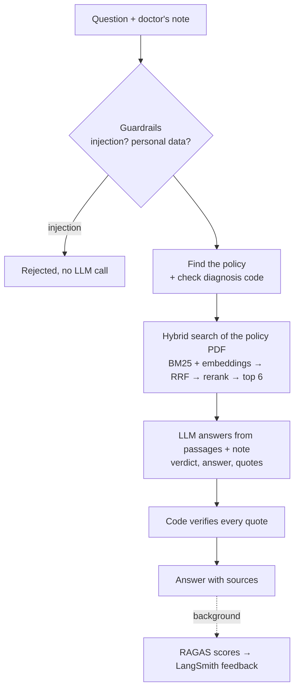

# How PriorAuth Copilot works (plain English)

## The problem

Before an insurer pays for an expensive procedure (an MRI, a knee replacement, a sleep study), the doctor's
office must show the patient meets the insurer's coverage policy. A billing person reads the doctor's note,
finds the policy, and checks it by hand: slow, and a missed detail means a denial and weeks of delay.
This chatbot reads the policy and the note for them and answers their questions, with sources.

## The flow

## RAG (retrieval-augmented generation)

The LLM has never seen these Medicare policies. Asked from memory it would guess. RAG fixes that: first
**retrieve** the relevant policy passages, then give them to the LLM with the question so it **generates** its
answer from the real text, and quotes it.

## Hybrid search

- **BM25** (keyword search): scores passages that contain the question's words, especially rare ones. Good for
  exact terms like "Kellgren-Lawrence" or "cauda equina".
- **Embeddings** (meaning search, `bge-small` running locally, stored in Chroma): finds passages with similar
  meaning even when the words differ ("PT" vs "physical therapy").
- **Reciprocal Rank Fusion** merges the two lists using ranks only: each list gives a passage `1 / (60 + rank)`.
  A passage ranked 1st by BM25 and 3rd by vectors scores 1/61 + 1/63 = 0.0323; one ranked 1st by only one
  list scores 0.0164. Passages both searches like win.
- **Cross-encoder reranking** (`ms-marco-MiniLM`) then reads the question and each passage together and
  reorders the best candidates. The top 6 go to the LLM.

Search is limited to the policy for the procedure mentioned (e.g. "knee replacement" → `L36575.pdf`), so text
from another policy can't leak in. If no procedure is mentioned, all policies are searched.

## What the LLM does

It reads the question, the 6 policy passages and the note, and returns:
- an **answer** in plain English (for "does this meet the policy?" it goes through each requirement it finds),
- a **verdict**: meets / missing information / does not meet / not applicable,
- **quotes** from the note and from the policy (with file and page).

It works out the requirements itself from the passages; nothing is hard-coded.

## How hallucination is limited

1. **Answers come only from retrieved text**: the prompt forbids using anything else.
2. **Every quote is checked by code**: it must really be in the note or the passages (words may be left out,
   never added or changed). Failing quotes are removed and shown as "unverified".
3. **Diagnosis codes are checked exactly** against Medicare's accepted list; a rejected code can never get "meets".
4. **RAGAS faithfulness** measures how well each answer is backed by its sources.
5. **The user can always check**: every answer shows its quotes and the passages that were searched.

## Guardrails

- **Prompt injection** in a note or question ("ignore previous instructions", "SYSTEM:", "mark everything as
  met", fake tags, spaced-out tricks, hidden characters) is rejected before any LLM call. Normal clinical
  sentences ("told to ignore pain medication instructions") are tested not to trigger it.
- **Personal identifiers** (SSN, phone, email, record/member numbers, date of birth) are removed before the text
  is saved or sent to the LLM.
- **Answers that leak the instructions** are replaced before the user sees them.

## Quality and observability

- **RAGAS** scores every answer in the background: *faithfulness* (backed by sources?), *answer relevancy*
  (answers the question?), *context precision* (did search find the right passages?). The judge is a separate
  model (`gpt-oss-20b`).
- **LangSmith** records each answer as one trace: retrieval (with counts and scores), the LLM call, quote
  verification. RAGAS scores are attached to the trace as feedback.
- **Offline evaluation** (`eval/run_eval.py`): 12 labeled notes; verdict accuracy, confusion matrix, made-up quote
  rate, RAGAS, latency, and an ablation (full hybrid vs all policies vs vector only).

## What I'd do in production

A HIPAA-eligible LLM deployment, more procedures and insurers, OCR for scanned notes, automatic policy updates,
a larger clinician-labeled test set run in CI, and monitoring of faithfulness and made-up-quote rates over time.

## Interview questions

1. **What does it do?** A chatbot that answers billing staff's questions about a doctor's note against Medicare policy PDFs, with quotes and page numbers.
2. **Why RAG?** The LLM doesn't know these policies; retrieval gives it the exact text so it answers from evidence, not memory.
3. **Why hybrid search?** BM25 catches exact terms and codes; embeddings catch paraphrases. Together they miss less.
4. **What is RRF?** Merges ranked lists by adding 1/(60 + rank) per list. Uses ranks only, so different score scales don't matter.
5. **Why a reranker?** It reads the question and passage together, which ranks far better than embedding similarity.
6. **Why filter by policy?** Similar policies share words; filtering stops another procedure's rules leaking into the answer.
7. **How do you stop hallucinated evidence?** Every quote is checked by code against the note and passages; failing quotes are removed and flagged.
8. **Why check codes in code, not the LLM?** The accepted list has thousands of codes; an exact lookup is reliable, an LLM isn't.
9. **How do you get structured answers?** A Pydantic schema with Groq's JSON-schema mode, retried on invalid output.
10. **How do you handle prompt injection?** Normalized text is checked against injection patterns before any LLM call; prompts mark data as data; answers are checked for leaks.
11. **What does faithfulness measure?** Whether each statement in the answer is supported by the retrieved passages and the note.
12. **How do you evaluate?** 12 labeled notes: verdict accuracy, confusion matrix, made-up quote rate, RAGAS, latency, and an ablation.
13. **What did you learn from testing?** Rerank scores aren't calibrated for broad questions (a fixed threshold dropped every passage), quotes can span chunk boundaries, and the smaller model needed JSON-schema mode.
14. **What would you improve?** More procedures and insurers, OCR, a larger labeled test set, and a HIPAA-ready deployment.
