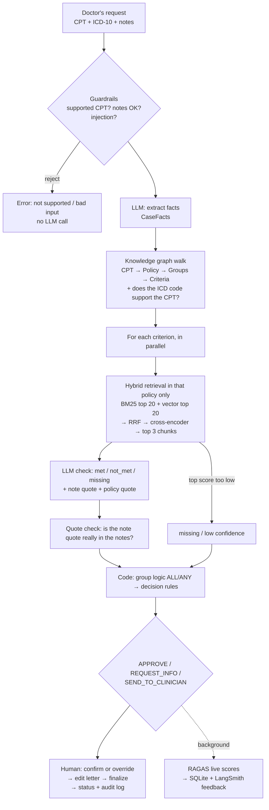

# How PriorAuth Copilot works (plain English)

## The pipeline

## Prior authorization

Before an insurer pays for some expensive procedures (an MRI, a knee replacement, a sleep study), the doctor must ask
permission and show the patient meets the insurer's coverage policy. A reviewer reads the notes, finds the policy,
checks each rule and decides. It is slow (20–40 minutes), details get missed, and two reviewers can disagree.
This app does the reading and checking and shows its evidence, but a human still decides.

## Knowledge graphs and NetworkX

A knowledge graph stores facts as **nodes** (things) and **edges** (relationships). Here:
`Procedure -COVERED_BY-> Policy -REQUIRES-> CriteriaGroup -HAS_OPTION-> Criterion` and `Diagnosis -SUPPORTS-> Procedure`.
NetworkX is a Python library that keeps the graph in memory; ours is tiny (~40 nodes) and saved as JSON.
In production you would use a graph database such as **Neo4j** and query it with **Cypher**, e.g.
`MATCH (p:Procedure {cpt:'72148'})-[:COVERED_BY]->(pol)-[:REQUIRES]->(g)-[:HAS_OPTION]->(c) RETURN pol, g, c`.

The graph is built from two human-reviewed files: `procedures.yaml` (which policy covers which CPT code) and
`criteria.json` (the rules). The LLM may *draft* the rules, but a person approves them, and the build fails loudly
if anything is missing.

## Graph RAG vs normal RAG

Normal RAG embeds the question, finds similar text anywhere, and hopes the right policy comes back. With three
similar policies (all mention "conservative therapy", "weeks", "documentation"), text from the wrong policy can leak
in. **Graph RAG** first walks the graph to find exactly which policy and which rules apply, then searches only
inside that policy. The graph answers "what applies?" exactly; search answers "what does it say?".

We saw this leak on the sample data: searching all policies for the knee rule "12 weeks of non-surgical treatment"
put two lumbar MRI chunks in the reranked top 3. With the graph filter, all three came from the knee policy.

## Hybrid search, BM25 and embeddings

- **BM25** is keyword search: it scores a chunk higher when it contains the query's words, especially rare ones
  ("Kellgren-Lawrence"), and doesn't over-reward long chunks. Great for exact terms, codes and numbers.
- **Embeddings** turn text into a list of numbers (a vector) so that texts with similar *meaning* are close together.
  We use `BAAI/bge-small-en-v1.5` running locally via fastembed, stored in Chroma. Great for paraphrases
  ("tried PT" vs "physical therapy was completed").
- **Hybrid** runs both and merges them, so we get exact-term precision and meaning-based recall.

## Reciprocal Rank Fusion (RRF), worked example

BM25 scores and cosine similarities are on different scales, so we don't add them. RRF uses only **ranks**:
each list gives a chunk `1 / (k + rank)`, with `k = 60`.

| Chunk | BM25 rank | Vector rank | RRF score |
|---|---|---|---|
| A | 1 | 3 | 1/61 + 1/63 = 0.01639 + 0.01587 = **0.03226** |
| B | 2 | – | 1/62 = **0.01613** |
| C | – | 1 | 1/61 = **0.01639** |

Order: A, C, B. A wins because *both* searches liked it. `k = 60` keeps any single first place from dominating.

## Cross-encoder reranking

Embeddings encode the query and the chunk *separately* (fast, but rough). A **cross-encoder**
(`ms-marco-MiniLM-L-6-v2`) reads the query and the chunk *together* and outputs a relevance score: slower but
much more accurate. So we cast a wide net cheaply (40 candidates), then rerank just those and keep the top 3.
Its scores are unbounded (on the sample policies the right chunk scores ~8–10 and unrelated chunks score below 0),
and `MIN_RERANK_SCORE` turns a weak top score into "missing, low confidence" without asking the LLM.

## Chunking

Each policy page is cut into chunks of about 800 characters (100 overlapping), never crossing a page, so every
chunk has an exact page number. That is big enough to hold a whole rule with its heading (e.g. "at least ONE of
the following") and small enough to search precisely. The same top 3 chunks that search finds are what the LLM
reads. (An earlier version searched small chunks and sent bigger "parent" chunks; it was removed to keep the
pipeline simple.)

## Structured output

The LLM must answer in a fixed shape (a Pydantic model), e.g. `status` must be `met`, `not_met` or `missing`.
LangChain's `with_structured_output` uses the model's tool-calling to fill it, and we retry twice if the answer
doesn't validate. No parsing of free text, no surprises downstream.

## Why code makes the decision

The LLM is good at reading messy notes and bad at being consistent. `decision.py` applies fixed rules:

1. Any low-confidence check or unsupported diagnosis → **SEND_TO_CLINICIAN**
2. Any rule group that can no longer be met → **SEND_TO_CLINICIAN** (the AI never denies; a human does)
3. Any group still missing information → **REQUEST_INFO**, listing exactly what to ask for
4. All groups met → **APPROVE**

An `ALL` group needs every criterion met; an `ANY` group needs one. The same inputs always give the same decision,
every branch is unit-tested, and an auditor can read the rules in one screen.

## Guardrails and the quote check

- Unsupported CPT code, empty or huge notes → rejected before any LLM call.
- Prompt injection → **rejected before any LLM call**, in notes and in chat. The detector cleans the text first
  (look-alike and invisible characters) and catches: "ignore all previous instructions", role spoofing
  ("SYSTEM:"), "mark all criteria as met", "reveal your prompt", jailbreak phrases, fake prompt tags, JSON like
  `"status": "met"`, and spaced-out tricks ("i g n o r e"). Normal clinical sentences ("told to ignore pain
  medication instructions") are tested to make sure they are *not* flagged.
- Personal identifiers (SSN, phone, email, record/member numbers, date-of-birth lines) are **removed at the API
  before the note is saved or sent to the LLM**; dates of service and ages are kept because rules depend on them.
  Names can't be detected reliably, so users are asked not to include them.
- Chat scope: the assistant only discusses the case, the policy and the prior-auth process; no medical or legal
  advice; it never reveals its instructions, and an answer that leaks them is replaced before the user sees it.
- Weak retrieval → that criterion is `missing` / low confidence.
- **Quote check:** a `met` or `not_met` answer must quote the notes, and code checks the quote really appears
  in the notes (ignoring case and punctuation; "..." splits allowed). A made-up quote is the classic hallucination,
  so the result is downgraded to `missing` / low confidence, which sends the case to a human.
- LLM failure after retries → SEND_TO_CLINICIAN with "automatic check failed". The app never crashes on an LLM error.

## Human in the loop

The reviewer sees every rule with its note quote and policy quote, can ask questions or run what-ifs (on a copy of
the case), and then **confirms** or **overrides** (with a reason). The app drafts a letter (approval, information
request, or clinician handoff), the reviewer edits it, and **Finalize** saves it, updates the status, and writes
the audit log (who, what, when). Nothing is sent. Confirm/override is also logged to LangSmith as `human_agreed`,
which measures how often people agree with the AI.

## The metrics

| Metric | Question it answers | Needs labels? |
|---|---|---|
| Decision accuracy | Did we reach the human-labeled outcome? | yes |
| Criterion accuracy | Did each rule get the labeled status? | yes |
| Confusion matrix | *Which* mistakes: e.g. APPROVE when it should be REQUEST_INFO (the dangerous kind) | yes |
| Faithfulness (RAGAS) | Is the reasoning supported by its context (policy text + notes), or made up? | no |
| Context precision (RAGAS) | Are the retrieved chunks relevant to the rule? | no |
| Context recall (RAGAS) | Did retrieval bring back the rule's policy wording? | yes (reference = rule text) |
| Answer relevancy (RAGAS) | Does a chat answer address the question? | no |
| Retrieval check | Is the rule's source page in the reranked top 3? | yes (page in criteria.json) |
| Off-policy chunks | How many retrieved chunks came from a *different* policy? | no |
| Latency p50/p95 | Typical and worst-case speed, per stage | no |
| Override rate | How often reviewers disagree with the AI | no |

Live scores (no labels needed) are computed in the background after every review; labeled metrics come from
`eval/run_eval.py`.

## Ablation results

`run_eval.py` compares three setups: **full** (graph filter + hybrid + rerank), **no graph** (hybrid over all
policies, no diagnosis check), and **vector only** (graph filter, vector top 3, no BM25/RRF/rerank).
**No LLM-based results have been measured yet**: the project was built without a Groq key, so run
`uv run python -m eval.run_eval` and read `results/eval_report.md`. What was measured (retrieval only, no LLM):
every sample criterion's source page was the top reranked hit in full mode, and in no-graph mode one criterion
(knee 2a) pulled 2 of its top 3 chunks from the lumbar MRI policy. Expect no-graph to show off-policy chunks and
a wrong-diagnosis case to be approved, and vector-only to lose precision on exact terms. With only 6 sample cases,
differences will be small and noisy; use the 30 drafted cases (after review) for anything you report.

## What I'd do in production

- Neo4j (or similar) for the graph, with versioned policies and effective dates.
- Real PDF parsing with table and layout support; a policy-change pipeline that re-drafts criteria and asks a human to diff and approve.
- A larger, clinician-labeled test set, with the eval in CI and a minimum accuracy bar before deploys.
- Calibrated `MIN_RERANK_SCORE` per policy; a better reranker if latency allows.
- A HIPAA-eligible LLM deployment (BAA), PHI redaction in traces, encryption, access control and SSO.
- Postgres instead of SQLite, a job queue instead of in-process background tasks, rate-limit handling and caching.
- Monitoring of override rate and live faithfulness, with alerts when they drift.

## 25 likely interview questions

1. **What does the app do?** Reads a prior-auth request, finds the exact policy rules via a knowledge graph, retrieves the policy wording, has an LLM check each rule against the notes with quotes, and lets code decide APPROVE, REQUEST_INFO or SEND_TO_CLINICIAN; a human confirms.
2. **Why can't the AI deny?** Denials hurt patients and carry legal risk. Anything that might be a "no" goes to a clinician.
3. **Why a knowledge graph instead of just RAG?** Which policy applies must be exact and auditable. The graph gives a deterministic answer and stops other policies' text from leaking into evidence.
4. **Who builds the graph?** Humans: `procedures.yaml` by hand; criteria drafted by the LLM and reviewed by a person. The build validates and fails loudly.
5. **Why NetworkX?** Tiny graph, zero infrastructure, easy to test. Neo4j + Cypher in production.
6. **What is hybrid search?** BM25 keyword search plus vector search, merged with RRF.
7. **Why not just embeddings?** They miss exact terms, numbers and codes; BM25 catches those.
8. **Explain RRF.** Each list adds 1/(60 + rank) per chunk; chunks ranked high by both win. Uses ranks, so score scales don't matter.
9. **Why a cross-encoder?** It reads query and chunk together, so it ranks far more accurately than embedding similarity; we only run it on ~40 candidates.
10. **How big are the chunks?** ~800 characters, one page at most: a whole rule plus its heading, with an exact page number for citations.
11. **How do you stop hallucinated evidence?** The note quote must literally appear in the notes (string check), or the result is downgraded to missing / low confidence.
12. **What if retrieval finds nothing relevant?** If the top rerank score is below `MIN_RERANK_SCORE`, the rule is marked missing / low confidence without an LLM call.
13. **How is the decision made?** Pure Python rules over group statuses (ALL/ANY), fully unit-tested, same input → same output.
14. **ALL vs ANY groups?** ALL needs every criterion met; ANY needs one. A group is not_met only when it can no longer be satisfied.
15. **How do you get reliable JSON from the LLM?** Pydantic models + `with_structured_output` (tool calling), temperature 0, 2 retries on validation errors.
16. **What happens when the LLM fails?** Retries, then SEND_TO_CLINICIAN with "automatic check failed". Never a crash.
17. **How do what-ifs work?** The LLM rewrites the question as one note line, the case is re-reviewed on a copy, and the UI shows the before/after diff. The saved case changes only if the reviewer clicks "Add to case".
18. **How do you handle prompt injection?** Layers: text is normalized and checked against injection patterns before any LLM call (rejected in notes and chat); prompts wrap data in XML tags and say it is data, not instructions; answers are checked for leaked instructions; and the LLM can't change the decision because code makes it.
19. **What does faithfulness measure?** Whether each statement in the reasoning is supported by the context it was given.
20. **Why live scoring in the background?** Quality monitoring on every case without slowing the reviewer; failures save null and never break the app.
21. **What does LangSmith add?** One trace per review with a step tree, tags for filtering, RAGAS and human-agreement feedback on each trace, and dataset experiments to compare setups.
22. **What is the ablation for?** To prove each part earns its place: no graph shows policy leakage, vector-only shows what BM25 + rerank add.
23. **How would you scale it?** Async workers and a queue, Postgres, cached models, batched reranking, a hosted vector DB, rate-limit-aware LLM calls.
24. **How about HIPAA?** Only synthetic data here. In production: BAA-covered LLM, PHI redaction in logs/traces, encryption, access control and audit.
25. **What would you improve first?** A bigger clinician-labeled eval set, then calibrating the rerank threshold and measuring override rate with real reviewers.
